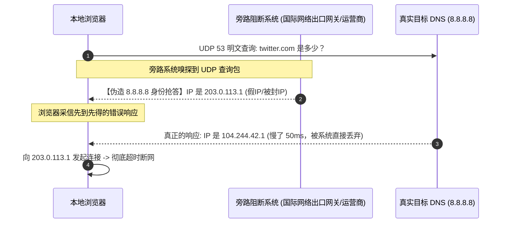

# DNS 污染劫持与真实 IP 泄漏排查：Fake-IP 原理与防运营商劫持完全指南

> [!IMPORTANT]
> **【Direct Answer / DNS 防污染与防泄漏核心三原则】**
> 在复杂的网络分流环境中，**95% 的“外网打不开/跳转反诈页面”和“代理后仍暴露真实家庭 IP”的事故，根源都在于本地 DNS 遭遇运营商抢答投毒或浏览器的 WebRTC 协议发生了直接穿透**。
> 构建绝对纯净、防污染、零泄漏的分流网络，必须恪守以下 **3 条技术铁律**：
> 1. **代理客户端强制启用 Fake-IP 模式**：本地协议栈向应用程序直接返回虚拟私有地址（`198.18.0.0/16`），将域名解析决策延迟到远程落地节点执行，物理上免疫国内无状态 UDP 53 端口的 DNS 抢答污染；
> 2. **境内外 DNS 严格物理隔离分流**：国内域名交由腾讯/阿里安全 DNS（`119.29.29.29` / `223.5.5.5`）解析以获取最优 CDN 接入点，境外受限域名必须走加密代理隧道由海外节点代为远程解析；
> 3. **浏览器端彻底阻断 WebRTC 真实 IP 穿透**：通过禁用浏览器底层 mDNS / STUN 穿透接口，杜绝网页利用 JavaScript 直接获取并向境外网站上报你家的真实公网 IP。

---

## 01 核心模型对比：Fake-IP vs Redir-Host vs 传统本地解析

很多用户在客户端（如 Clash Verge Rev、Mihomo、Sing-box、OpenClash）的设置中经常看到 **Fake-IP** 与 **Redir-Host** 这两种模式，却不清楚它们的底层运行机制。

通过下表全面了解主流 DNS 工作模式的底层差异与优缺点：

| 评估维度 | Fake-IP 模式 (工业界首选推荐) | Redir-Host 模式 (传统真实解析) | 传统操作系统本地解析 (裸连直连) |
| :--- | :--- | :--- | :--- |
| **底层工作原理** | 客户端内置 DNS 拦截系统解析请求，立即从 `198.18.0.0/16` 地址池分配一个假 IP 返回给应用程序，并在内存建立映射表。 | 客户端在本地等待上游远程 DNS 返回真实的境外 IP，再将真实 IP 注入路由表实施重定向。 | 操作系统直接向本地运营商（LocalDNS）明文 UDP 53 端口发起查询。 |
| **域名解析发生位置** | **远程境外代理服务器**（端到端握手时，客户端仅向节点传输域名，由节点就近解析）。 | **本地客户端前置解析**（必须在建立 TCP 连接前获取真实 IP）。 | **本地运营商递归解析器**。 |
| **防国际出口网关 / 运营商投毒能力** | **100% 物理免疫**（本地根本不向外部发送真实查询，投毒包完全无效）。 | ★★☆☆☆（依赖本地加密 DoH/DoT；若遭遇抢答依然可能被带偏）。 | 0%（极易被抢答伪造 IP 或拦截到反诈落地页）。 |
| **端到端首包延迟 (RTT)** | **0 毫秒即时响应**（无需等待海外 DNS 往返耗时，浏览器秒开连接）。 | 较慢（必须等待海外 DNS 查询完成，通常额外增加 150ms - 400ms 握手等待）。 | 快（但返回的是被污染的死 IP 或反诈拦截 IP）。 |
| **对特殊应用与游戏的兼容性** | 98% 极高（仅个别外服主机联机游戏或老旧 P2P 需加入 `fake-ip-filter` 白名单）。 | 100% 兼容全部原生协议，但性能开销与污染风险大。 | 原生兼容，但境外服务大面积瘫痪。 |
| **综合推荐指数** | ★★★★★ (**强烈推荐日常主力使用**) | ★★☆☆☆ (仅作为特定网络调试备用) | ☆☆☆☆☆ (严禁在跨境网络中裸用) |

---

## 02 原理深度拆解：DNS 污染与运营商劫持底层机制

### 1. 为什么明文 UDP 53 端口会发生“DNS 抢答投毒”？
传统的 DNS 协议基于无状态的 **UDP 53 端口** 进行明文通信。其工作流程存在先天性的重大安全缺陷：
- 当你的浏览器尝试访问境外受限域名（如 `google.com` 或 `twitter.com`）时，系统会向 DNS 服务器发送一个明文 UDP 查询包。
- 部署在国际出口路由旁路上的阻断设备（国际网络出口网关）以及部分省份的本地运营商系统，采用了**旁路监听与抢答注入机制**。
- 旁路审查系统在嗅探到包含敏感域名的 UDP 查询包瞬间，无需等待真正的目标 DNS 服务器回应，而是**伪造目标 DNS 服务器的源 IP 地址，以极快的纳秒级速度向你的电脑回推一个错误的响应包（如 `0.0.0.0`、`127.0.0.1` 或虚假的境外 IP）**。
- 客户端操作系统遵循“先到先得”的 UDP 协议规范，一旦采信了先到达的伪造响应包，就会将真实的境外正常响应包直接丢弃。结果是你的电脑拿到了一个根本不存在的假 IP，从而触发 `ERR_CONNECTION_TIMED_OUT` 或重定向至本地反诈中心。



### 2. 为什么开了代理，依然打不开外网或跳转反诈页面？
许多用户在遇到断网排障时经常疑惑：“我的客户端已经显示连通了，为什么在 Chrome 浏览器里打不开网页，甚至跳转到了运营商的防诈拦截提示？”
**原因剖析**：
1. **浏览器 LocalDNS 残留缓存**：在开启代理客户端前，浏览器或者 Windows 系统的 DNS 客户端服务（`dnscache`）已经将此前被污染的解析记录缓存在了内存中。即使代理已启动，浏览器仍优先读取了本地的错误 IP。
2. **分流模式处于 Redir-Host 且上游使用了国内明文 DNS**：客户端核心在处理分流前，自己先向本地电信/移动的 53 端口解析了境外域名，被运营商直接识别并注入了拦截指令。详细排障流程请参考本站核心指南 [连通成功但网页打不开](/troubleshooting/connected-no-internet/)。

---

## 03 原理深度拆解：WebRTC STUN 穿透真实 IP 泄漏危机

即使你的 DNS 解析完全正确、海外网页也能秒开，你依然可能处于“**完全被目标网站脱敏识别真实身份**”的极端危险中。导致这种现象的罪魁祸首就是 **WebRTC（Web Real-Time Communication）**。

### 1. 什么是 WebRTC 穿透漏洞？
WebRTC 是一项被现代主流浏览器（Google Chrome、Microsoft Edge、Apple Safari、Firefox）广泛支持的网页端实时音视频通信技术（常用于网页版腾讯会议、Google Meet、Discord 等）。
- 为了在局域网复杂 NAT 网络下实现端到端低延迟直连，WebRTC 协议内置了 **STUN（Session Traversal Utilities for NAT）和 ICE 探测机制**。
- **致命安全隐患**：网页中的恶意 JavaScript 脚本无需经过任何用户授权弹窗，即可直接调用浏览器的 `RTCPeerConnection` 接口，向 STUN 服务器发起静默探测。
- 这种 UDP 探测数据包**具有绕过操作系统普通 HTTP/SOCKS5 系统代理设置的特性**。
- STUN 服务器在收到数据包后，会直接将你当前家庭宽带的真实公网 IP（如 `116.23.x.x`）反馈给浏览器内部，网页 JavaScript 即可瞬间读取并上报给服务器。

> [!WARNING]
> 这就是为什么很多人访问海外隐私测试站（如 whoer.net 或 browserleaks.com）时，虽然节点出口显示为美国，但在 **WebRTC 区域却赤裸裸地暴露着你家里的真实运营商省份、城市与公网 IP**。对于使用海外 AI 服务（ChatGPT、Claude）、跨境电商运营、海外自媒体账号管理的用户，真实 IP 的暴露会直接触发平台的风控审计，导致账号被批量封禁。

### 2. 浏览器彻底杜绝 WebRTC 泄漏的标准化操作

#### 方案一：在 Chrome / Edge 中彻底封堵（首选插件防护法）
由于最新版 Chromium 内核移除了手动完全关闭 WebRTC 的深层 Flags，最稳妥、防穿透的工业级方案是安装开源安全扩展：
1. 前往 Chrome 应用商店，搜索并安装官方开源的 **WebRTC Control** 或 **uBlock Origin**；
2. 若使用 **WebRTC Control**，将插件状态切换为 **「Blue（完全禁用 WebRTC）」**；
3. 若使用 **uBlock Origin**，进入扩展设置 -> 勾选 **「阻止 WebRTC 泄露本地 IP 地址 (Prevent WebRTC from leaking local IP address)」**。

#### 方案二：在 Firefox (火狐浏览器) 中原生彻底禁用
Firefox 支持在底层配置文件中硬核关闭 WebRTC 模块：
1. 在 Firefox 地址栏输入 `about:config` 并按回车，点击接受风险继续；
2. 在顶部搜索框中输入：`media.peerconnection.enabled`；
3. 双击该项，将其布尔值由默认的 `true` 切换为 **`false`**；
4. 重启 Firefox 浏览器，WebRTC 模块将被彻底物理切断。

完成配置后，可前往本站 [实用网络与订阅工具箱](/tools/) 中的「WebRTC 泄漏与 IP 纯净度检测」模块，实时验证真实 IP 是否已成功隐藏。

---

## 04 原理深度拆解：DoH 与 DoT 加密防护屏障

为了化解明文 UDP 53 端口的监听与劫持风险，IETF 组织先后推出了两大加密 DNS 标准：**DoT (DNS over TLS)** 与 **DoH (DNS over HTTPS)**。

### 核心参数与抗封锁表现对比

| 协议标准 | 传输层载体与端口 | 加密形式 | 运营商审查辨识特征 | 国内网络环境抗封锁能力 |
| :--- | :--- | :--- | :--- | :--- |
| **传统 DNS** | UDP / TCP 53 端口 | 完全明文（无加密） | 特征极其明显，极易旁路嗅探 | **0% 极差**（随时被抢答污染） |
| **DoT** (RFC 7858) | TCP 853 端口 | 专属 TLS 加密隧道 | 端口固定为 853，运营商可直接阻断整个 853 端口 | ★★☆☆☆（易遭到特定端口封锁与丢包干扰） |
| **DoH** (RFC 8484) | 标准 HTTPS 443 端口 | 伪装在正常 HTTPS 流量中 | 流量特征与普通网页访问完全一致，难以区分拦截 | ★★★★☆（**当前公认最稳健的防劫持防线**） |

> [!NOTE]
> **常见认知误区**：很多人以为在 Windows 网络设置中将 DNS 手动改成 `1.1.1.1` 或 `8.8.8.8` 就能防劫持。**这是绝对错误的！**
> 只要你采用的是传统 UDP 53 端口通信，哪怕你指定的服务器在地球另一端，发出的数据包也会在穿过运营商机房网关的瞬间被旁路系统拦截并伪造回复。因此，**必须通过客户端内核内置的 DoH/DoT 模块在建立加密连接的前提下发起查询**。

---

## 05 客户端最佳实践配置示范（Mihomo / Clash Verge Rev）

在客户端的配置文件中，构建一个**分流明确、境内外互不干扰且无死锁的 DNS 策略组**，是彻底解决 DNS 污染的终极方案。

以下是专为基于 Mihomo / Meta 内核的客户端量身定制的标准化 `dns` 模块优化配置：

```yaml
# =========================================================
# 工业级高性能防污染 DNS 模块最佳实践配置 (Mihomo/Meta)
# =========================================================
dns:
  enable: true
  listen: 0.0.0.0:1053
  ipv6: false                         # 彻底关闭 IPv6 DNS 查询，杜绝移动宽带双栈路由漏泄
  enhanced-mode: fake-ip              # 必须启用 fake-ip 模式以实现 0 毫秒首包解析
  fake-ip-range: 198.18.0.1/16       # 遵循 RFC 2544 标准保留测试地址段
  
  # 必须放行的 Fake-IP 白名单（避免联机游戏、局域网探测与特殊国内软件报错）
  fake-ip-filter:
    - "*.lan"
    - "*.local"
    - "localhost.ptlogin2.qq.com"     # 微信/QQ 网页端扫码登录互联
    - "+.nintendo.net"                # 任天堂 Switch 联机认证
    - "+.srv.nintendo.net"
    - "+.stun.playstation.net"        # PS5 联机 NAT 探测
    - "xbox.*.microsoft.com"          # Xbox Live 联机服务
    - "+.music.163.com"               # 网易云音乐版权直连
    - "+.126.net"
    - "connectivitycheck.gstatic.com"
    - "detectportal.firefox.com"

  # 基础命名服务器（用于解析后续 DoH 域名本身的真实物理 IP）
  default-nameserver:
    - 223.5.5.5
    - 119.29.29.29

  # 国内主流分流 DNS（仅用于解析国内直连网站，保障高吞吐与精准 CDN 定位）
  nameserver:
    - https://dns.alidns.com/dns-query   # 阿里 DoH
    - https://doh.pub/dns-query           # 腾讯 DNSPod DoH

  # 备用与规则回退 DNS（经由代理节点加密隧道查询的纯净境外解析源）
  fallback:
    - https://1.1.1.1/dns-query           # Cloudflare 加密 DoH
    - https://8.8.8.8/dns-query           # Google 加密 DoH
    - tls://dns.google:853                # Google 加密 DoT

  # 境外域名的解析走 fallback 策略
  fallback-filter:
    geoip: true
    geoip-code: CN
    geosite:
      - gfw
    ipcidr:
      - 240.0.0.0/4
```

### 配置亮点与排坑细节：
1. **`ipv6: false` 的必要性**：目前许多国内家庭宽带默认下发了 IPv6 地址，但部分服务商的落地节点并未配置完整的 IPv6 出口，这会导致浏览器在尝试 IPv6 AAAA 记录优先通信时陷入长达 3 秒的等待假死，将其关闭可大幅提升上网流畅度。
2. **`fake-ip-filter` 避坑清单**：任天堂 Switch、索尼 PS5 等联机游戏设备如果被分配了 `198.18.x.x` 的假 IP，会导致主机的 P2P NAT 探测失败并直接报 `NAT Type D / F` 无法联机。将其加入白名单后，游戏流量会获得真实的公网映射。
3. 如果由于节点测速端点失效导致节点全红，请参阅 [节点全红 Timeout 与 0ms 诊断](/troubleshooting/timeout/) 进行排查。

---

## 06 常见问题 FAQ（高频疑难技术问答）

### Q1：开启 Fake-IP 后，电脑上查到的解析 IP 全是 198.18 开头的是中毒了吗？
> **核心解答**：
> **完全正常，这正是 Fake-IP 模式生效的标志**。
> `198.18.0.0/16` 是国际互联网工程任务组（IETF）在 RFC 2544 中定义的专用保留测试地址段，绝不会分配给公网上的任何真实服务器。客户端内置的 DNS 服务器故意将这个假 IP 返回给你的浏览器，目的是让浏览器立即开始建立 TCP 握手。与此同时，客户端内核会在底层数据包过境时，将目标假 IP 还原为真正的域名，并通过代理隧道发送给海外远程节点执行实际访问。

### Q2：为什么关闭客户端后电脑彻底连不上国内网了，提示 DNS 错误？
> **核心解答**：
> **这是由于客户端非正常退出（如崩溃、强制关机），未及时恢复操作系统的 DNS 网络栈配置所致**。
> 部分客户端在开启 TUN 模式或系统代理时，会将系统的物理网卡 DNS 指向 `127.0.0.1`。一旦软件关闭，本地没有服务监听该端口，系统便无法解析任何网站。
> **秒级自救指令（CMD 管理员模式）**：
> ```cmd
> netsh interface ip set dns name="以太网" source=dhcp
> netsh interface ip set dns name="WLAN" source=dhcp
> ipconfig /flushdns
> ```
> 更多系统网络层冲突自救方案，请参阅 [网络分流急救综合手册：三层金字塔排查法](/troubleshooting/guide/)。

### Q3：盲目在路由器或客户端配置大量公共 DoH 会降低上网速度吗？
> **核心解答**：
> **确实会降低首屏解析速度，不建议随意堆叠非本地 DoH**。
> DoH 基于完整的 HTTPS 协议，每次初次查询都需要经过 TCP 三次握手和 TLS 1.3 握手认证，开销远大于传统 UDP。如果你在国内网络直连环境下盲目配置了海外的 `1.1.1.1` DoH，解析国内网站（如淘宝、B站）不仅容易超时，而且海外 DNS 无法识别你的运营商归属，会返回离你极远的跨省甚至境外 CDN IP，导致看国内视频极其卡顿。国内流量请务必严格使用阿里或腾讯的国内 DoH 源。

### Q4：如何彻底检测我的网络到底有没有发生 DNS 泄漏？
> **核心解答**：
> 1. 打开本站 [实用网络与订阅工具箱](/tools/) 或访问国际权威测试站 `https://browserleaks.com/dns`；
> 2. 点击开始测试，观察页面列出的所有 DNS 服务器 IP 与国家旗帜；
> 3. **安全判定标准**：
>    - **安全无泄漏**：列表中显示的全部是海外机房的 IP（如 Cloudflare、Google、Quad9），并且**完全看不到任何中国电信、中国联通或中国移动的字样**；
>    - **严重泄漏**：若列表中赫然出现了你的真实宽带所在地或者国内运营商的 DNS 服务器 IP，说明你的境外流量正在被本地运营商监听与旁路分析，必须立即检查并启用客户端的 Fake-IP 模式与系统 DNS 劫持防护。

---

## 07 拓扑内链导航与故障急救全景索引

- 返回排障决策全景树按现象定位问题 -> [排障总览与故障诊断树](/troubleshooting/)
- 本地系统代理与虚拟网卡死锁综合急救 -> [网络分流急救综合手册：三层金字塔排查法](/troubleshooting/guide/)
- 测速全红 Timeout 与 0ms 故障深度排查 -> [节点全红 Timeout 与 0ms 诊断](/troubleshooting/timeout/)
- 节点绿灯但浏览器完全打不开网页 -> [连通成功但网页打不开](/troubleshooting/connected-no-internet/)
- 免费公共节点 DNS 劫持与中间人嗅探隐患 -> [免费公益节点隐患揭秘](/buying/free-risks/)
- 选购具备原生住宅纯净 IP、无 DNS 污染的顶级物理专线 -> [晚高峰抗封锁专线评测榜（IPLC/IEPL）](/rankings/iplc-iepl/)
