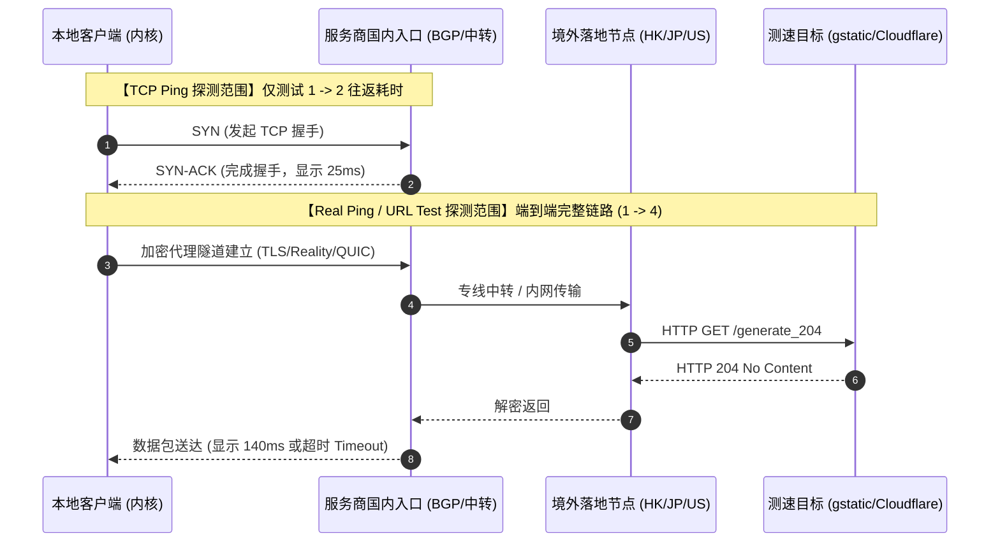

# 节点全红 Timeout 与 0ms 诊断：排查测速机制、入站阻断与全面修复方案

> [!IMPORTANT]
> **【Direct Answer / 节点全红 4 步秒判结论】**
> 在代理客户端中点击测速时，发现所有节点瞬间飘红显示 **`Timeout`** 或异常显示 **`0ms`**，**90% 的情况下并不代表服务商节点全线挂掉，而是客户端测速目标网址（URL Test）在国内不可达、本地 DNS 解析被污染，或系统安全防火墙静默拦截了代理内核套接字**。
> 遇到大面积飘红，请按以下 **4 步 30 秒急救法则** 快速定位并恢复：
> 1. **更换测速目标 URL**：将客户端默认的 `http://www.gstatic.com/generate_204` 临时更换为国内可达的高可用探测地址（如 Cloudflare 或高德/百度探测源），90% 的“全红”会瞬间恢复为真实绿色延迟；
> 2. **切换测速机制为 TCP Ping**：将 HTTP 业务层连通性测试切换为传输层 TCP 握手测速，排除应用层 HTTP 握手超时干扰；
> 3. **校准系统本地 NTP 时钟**：检查电脑/手机时间，若系统时间偏差超过 **90 秒**，TLS 1.3 握手鉴权将被强制中断导致批量超时；
> 4. **双向探测服务商入口 IP**：使用本机终端或第三方在线 Ping 工具测试节点入口 IP，确认是本地宽带阻断还是服务商专线入口正处于突发维护。

---

## 01 测速机制底层逻辑：TCP Ping 与 Real Ping 的本质区别

很多用户在遇到节点全红或显示 0ms 时，容易陷入恐慌或误判。要彻底根治测速异常，首先必须从网络工程原理上搞清楚：**客户端面板上的那个“毫秒数（ms）”，到底是怎么算出来的？**

不同的代理软件（如 Clash Verge Rev、Shadowrocket 小火箭、v2rayN、Sing-box）在底层采用了完全不同的探测协议与计算逻辑。



### 核心对比大表：测速机制区别与 Timeout 根因矩阵

| 测速机制 / 测试类型 | 底层工作原理 | 主要反映指标 | 可能导致全红超时的假死原因 | 准确度评级 | 典型客户端支持 |
| :--- | :--- | :--- | :--- | :--- | :--- |
| **TCP Ping**<br>*(传输层握手)* | 客户端仅向节点配置的域名/IP 目标端口发起三次握手（SYN -> SYN-ACK），收到回应即记录往返时间。 | **本地到前置入口**的物理传输延迟；入口服务器网络是否畅通。 | ① 入口 IP 遭遇国内防火墙端口封锁；<br>② 本地宽带 UDP/TCP 阻断；<br>③ 服务商前置机房维护。 | ★★☆☆☆<br>*(仅代表入口通畅)* | Shadowrocket (可配置)<br>v2rayN / v2rayNG |
| **HTTP(S) URL Test**<br>*(应用层连通性)* | 客户端通过节点代理隧道，向预设的目标 URL（如 Google 204）发送真实的 HTTP GET 请求，并统计收到 HTTP 响应的完整 RTT。 | **端到端全链路可用性**；境外出口能否真正向目标网站转发数据。 | ① 预设的测试 URL 本身被墙或服务器瘫痪；<br>② 节点出口 DNS 无法解析目标；<br>③ 本地系统时钟不同步导致 TLS 证书失效。 | ★★★★☆<br>*(推荐日常使用)* | Clash Verge Rev<br>Mihomo / FlClash<br>Surge / Loon |
| **Real Ping / 真连接延迟**<br>*(全链路业务握手)* | 在建立加密代理连接的基础上，测量完整 TLS 握手 + 首字节响应时间（TTFB）。 | 访问境外受限网站的**真实感知等待延迟**。 | ① 目标测试网址响应极慢；<br>② 节点遭遇恶劣丢包，TCP 重传导致耗时超过预设阈值（默认 5000ms）。 | ★★★★★<br>*(最真实可靠)* | v2rayN (Ctrl+R 真连接)<br>Shadowrocket 连通性测试 |
| **ICMP Ping**<br>*(网络层回显)* | 直接向目标服务器发送 ICMP Echo Request 数据包。 | 裸连 IP 的基础路由耗时。 | 现代高质量机场服务器普遍**禁用 ICMP 回显响应**，因此直接 ICMP Ping 必然 100% 丢包，极易误导新手。 | ★☆☆☆☆<br>*(无法代表代理状态)* | 操作系统终端 `ping` 命令 |

---

## 02 深入剖析：为什么小火箭会显示 0ms？为什么 Clash 频繁 Timeout？

### 1. Shadowrocket（小火箭）的“0ms”或“极低延迟”陷阱
许多 iOS 用户在使用 Shadowrocket（小火箭）测速时，经常看到节点列表瞬间刷出大量 **`0ms`**、**`1ms`** 或 **`2ms`** 的惊人数据，甚至误以为自己买到了“神仙专线”。

> [!WARNING]
> **技术真相揭秘**：
> 在 Shadowrocket 的旧版逻辑或特定配置下，当将测速方式设置为 TCP 测速时，如果手机本地开启了系统级网络保护、私有代理分流，或者当前网络正在遭遇本地局域网 DNS 劫持，TCP 握手包刚发出就在**本机回环地址（127.0.0.1）被拦截并瞬间返回了 RST/ACK**。
> 客户端内核将这种“本地瞬间拒绝”误判为“0 毫秒极速响应”。**显示 0ms 的节点 100% 无法联网**，其本质是连本地出站网络都未能穿透。

### 2. Clash / Mihomo 内核全红 Timeout 的“Gstatic 假死”现象
在 Windows 和 macOS 上使用基于 Mihomo / Clash Meta 内核的客户端（如 Clash Verge Rev、FlClash）时，最常遇到的现象是：**明明电脑能正常打开 YouTube 和 Google，但一点击测速，列表瞬间全是刺眼的红色 `Timeout`**。

这是由于 Clash 默认预设的测速地址为 Google 的空内容测试源：
```yaml
# Clash 默认的全局测速配置
url: http://www.gstatic.com/generate_204
interval: 300
timeout: 5000
```
- 客户端在发起测速时，Mihomo 内核会并发向所有节点推送探测请求。
- 如果服务商提供的分流规则中，未将 `www.gstatic.com` 划入代理规则；或者某些运营商对 `generate_204` 实施了针对性的 HTTP RST 干扰；亦或节点出站机房对于 Google 服务的 IPv6 解析存在路由黑洞，就会导致**HTTP 请求在 5000ms 内无法收尾**，内核直接判定为超时。
- 此时节点网络本身完全正常，但界面却呈现虚假的大面积飘红瘫痪状态。

---

## 03 节点全红三大核心诱因深度技术剖析

当你确认并非测试 URL 的误报，而是节点确实连不上时，故障必然归属于以下三大核心技术诱因之一：

```text
┌────────────────────────────────────────────────────────┐
│               节点大面积飘红的三大技术诱因              │
└────────────────────────────────────────────────────────┘
          │
          ├─► 【诱因一：测速目标网址与本地 DNS 劫持】 (占 45%)
          │     └─ gstatic 遭到本地污染、测试 URL 不可用、NTP 时钟偏差 >90s
          │
          ├─► 【诱因二：本地系统环境与安全策略截断】 (占 35%)
          │     └─ Windows Defender 阻断内核、杀软查杀、端口冲突与回环死锁
          │
          └─► 【诱因三：远程服务节点与前置入口阻断】 (占 20%)
                └─ 网络链路维护高发期 SNI 封锁、入口 IP 阻断、专线跳板维护、商户跑路
```

### 诱因一：测速目标配置失效与系统时钟偏差
1. **测试网址遭遇本地 DNS 污染**：客户端在发起测速前，需要将测试域名的解析请求交由本地网络栈处理。如果宽带运营商的 LocalDNS 对测速域名返回了错误的 NXDOMAIN，测速会在第一阶段直接夭折。
2. **NTP 时钟偏差超过 90 秒**：基于 TLS 1.3 协议的现代代理协议（如 [VLESS Reality 协议](/kb/vps/vless-reality)、Trojan、Hysteria2）均在握手包中包含了严格的时间戳校验机制（AEAD 防重放攻击）。若本地系统时间偏差超过 90 秒，远程服务器将直接拒绝解密握手包，导致全部节点在握手阶段超时熔断。详细排查步骤请参考 [网络分流急救综合手册：三层金字塔排查法](/troubleshooting/guide/)。

### 诱因二：本地安全防护软件与防火墙静默拦截代理核心
现代开源客户端多采用“前端 UI + 底层 Go/Rust 编译的核心二进制程序（如 `mihomo-windows-amd64.exe`、`clash-core.exe`、`xray.exe`）”分离架构。
- 当操作系统更新补丁或第三方杀毒软件（360、火绒、联想电脑管家、Windows Defender）扫描时，很容易将高并发网络转发行为判定为“可疑木马或端口扫描”。
- 杀毒软件往往不会弹窗提示，而是**直接在 Windows 底层 WFP（Windows Filtering Platform）网络过滤层拦截代理核心的入站与出站权限**。
- 其直接结果是：客户端 UI 界面可以正常点击，但核心发出的所有 TCP SYN 握手包都被本地驱动直接丢弃，导致所有节点全部显示超时。

### 诱因三：服务商前置入口遭遇端口阻断或专线维护
如果排除了本地环境问题，则属于远程链路故障：
- **普通公网直连节点**：境外 VPS 节点的 IP 或特定端口被国际出口网关通过边界主动探测（主动探测）锁定并加入黑名单，TCP 三次握手无法完成。
- **BGP 中转与内网专线节点**：虽然境外落地机房未被封，但服务商位于国内（如上海、深圳、广州）的前置中转服务器 IP 遭遇机房通报、DDoS 攻击或物理光缆割接维护。此时中转跳板失联，客户端到入口的连接彻底中断。详细线路机制请参阅 [线路科普：直连、中转、IPLC 专线全方位解析](/kb/concepts/routes-explained)。

---

## 04 手把手实操：4 步彻底修复节点全红与 0ms 假死

遇到节点全红时，请严格按照以下经过工程验证的标准流程进行排查与修复：

### 第一步：修改客户端测速目标 URL（秒级复活绿字）
将不可靠的默认探测网址替换为**高可用、低抖动且全球节点丰富的大厂探测端点**。

#### 1. 推荐测速 URL 权威列表：
- **Cloudflare 官方探测源（最稳定，推荐作为首选）**：
  `http://cp.cloudflare.com/generate_204`
- **Google 全球 CDN 备用源**：
  `http://www.google.com/generate_204`
- **针对国内分流与纯连通性测试（排查本地拦截）**：
  `http://connectivitycheck.platform.hicloud.com/generate_204` (华为)
  `http://wifi.vivo.com.cn/generate_204` (vivo)

#### 2. 在 Clash Verge Rev 中修改测速目标：
1. 打开 Clash Verge Rev -> 进入左侧 **「设置 (Settings)」**；
2. 找到 **「测速目标 (Test URL)」** 或在全局扩展配置中编辑；
3. 将原有的 URL 更改为 `http://cp.cloudflare.com/generate_204`；
4. 将 **「测速超时时间 (Timeout)」** 从默认的 5000ms 适当放宽至 **`8000ms`**；
5. 保存并重新在「代理 (Proxies)」界面点击测速闪电图标，观察节点是否转绿。

```yaml
# Clash / Mihomo 配置文件中的优化测速片段
proxy-groups:
  - name: 🚀 节点选择
    type: select
    proxies:
      - ♻️ 自动选择
      - 🇭🇰 香港 IPLC 专线
      - 🇯🇵 日本 BGP 优化
    url: 'http://cp.cloudflare.com/generate_204'
    interval: 300
    timeout: 8000
    lazy: false
    max-failed-times: 3
```

### 第二步：一键放行系统防火墙与解除核心端口拦截
排除 Windows Defender 将代理内核静默加入封锁名单。

以管理员身份启动 **PowerShell**，依次执行以下命令，为代理内核添加防火墙白名单：

```powershell
# 1. 检查是否存在拦截 Clash/Mihomo 的出站规则
Get-NetFirewallRule -DisplayName "*Clash*" | Select-Object Name, DisplayName, Enabled, Action

# 2. 强力放行当前正在使用的代理核心出站流量（以 Clash Verge 为例）
New-NetFirewallRule -DisplayName "ProxyCore_Outbound_Allow" -Direction Outbound -Program "C:\Program Files\Clash Verge\resources\clash-meta.exe" -Action Allow -Enabled True

# 3. 彻底重置 Winsock 网络底层套接字栈并清理 DNS 缓存
netsh winsock reset
ipconfig /flushdns
```
> 执行完成后，**建议重启电脑一次**，确保底层网络栈驱动完成重载。

### 第三步：双向探针定位入口阻断（排查是本地断网还是服务器宕机）
若更改测速 URL 后依然全红，请通过网络探针快速界定责任方：

1. **提取节点入口 IP 或域名**：
   在客户端中右键点击任意一个超时的节点 -> 查看节点配置信息，找到其 `server` 地址（如 `hk01.airport-node.com` 或 `118.123.x.x`）。
2. **在本地运行 TCPing 探测端口**：
   打开命令提示符（CMD），测试到该入口服务器的 TCP 握手：
   ```cmd
   curl -v telnet://hk01.airport-node.com:443
   ```
   - 若终端显示 `Connected to hk01.airport-node.com`，说明**国内入口完全正常**，问题出在服务商境外落地段或节点配置 Token 失效；
   - 若终端显示 `Connection timed out` 或 `Connection refused`，说明**该入口在国内已被防火墙屏蔽或机房已断网**。
3. **使用第三方全国拨测工具交叉比对**：
   打开国内知名的网络拨测站（如 [ITDOG 测速网](https://www.itdog.cn/tcping/)），输入该节点入口域名与端口，执行全国多地点 TCP Ping：
   - 若全国地图显示**全绿（全通）**，但你本地连接超时 -> **100% 为你所在的本地运营商（如特定省份移动/广电）发生了单向路由劣化或本地安全拦截**，切换手机 5G 热点即可秒解；
   - 若全国地图显示**大面积飘红** -> **100% 为服务商服务器入口遭到严重故障或跑路**。

### 第四步：检查账户凭证有效性与应急备用订阅
1. **排查套餐是否耗尽或被重置**：
   登录服务商后台控制台，查看你的账户总流量是否已经耗尽、套餐是否已过有效期。很多服务商在流量超标后，不会弹窗警告，而是直接在服务端将用户订阅的下发节点端口切断，引发全红。
2. **强制更新订阅配置**：
   服务商在遭遇入口被墙后，通常会在后台紧急下发全新的备用 IP。若客户端未自动同步，本地依然在请求已被废弃的旧 IP。
   - 在客户端中点击「刷新订阅 / Update」；
   - 若刷新订阅时提示错误，请参照 [订阅链接无法连接与更新报错](/buying/subscription-issues/) 进行深度排查。
3. **如果连通成功但网页依然打不开**：
   若节点测速已经成功转绿（如显示 45ms），但浏览器依然无法加载 Google 或 YouTube，说明问题已经脱离了节点层，转移至本地虚拟网卡与 DNS 路由层，请立即前往 [连通成功但网页打不开](/troubleshooting/connected-no-internet/) 查阅急救方案。

---

## 05 避坑指南：如何彻底远离“突发全红”与断联焦虑？

节点频繁大面积超时全红，本质上是由于服务商的网络架构缺乏弹性与冗余。低质量的小作坊“月抛机场”为了压低成本，通常采用单台普通公网 VPS 直连方案，一旦 IP 被识别，全部用户瞬间断流。

在选购与配置日常科学上网环境时，建议遵循以下两条工业级高可用法则：

1. **核心节点认准真正的物理专线与多入口 BGP Anycast**：
   优质服务商会在国内部署跨中国电信、联通、移动的三网 BGP 动态入口，并配备多地自动容灾备份。即使某一地入口机房光缆中断，BGP 协议会在 500ms 内将流量自动收敛切换至备用入口。在跨境段采用真正的内网专线（IPLC / IEPL），物理上绕过公网防火墙探测，从根源上终结大面积封锁。
   - 权威抗封锁专线横评：[晚高峰抗封锁专线评测榜（IPLC/IEPL）](/rankings/iplc-iepl/)
   - 避开虚标假专线套路：[新手选购 8 大避坑法则](/buying/traps/)
2. **常备异构双订阅作为“冷备份”**：
   不要将所有鸡蛋放在同一个篮子里。日常主力使用具备高 SLA 保障的年度稳定梯子（参见 [2026 稳定节点综合推荐榜](/rankings/best/)），同时在手机和电脑中导入一个低成本的小额备用订阅或纯按量计费节点。一旦主力网络遭遇不可抗力突发故障，一键切换备用节点，即可在 5 秒内恢复跨国办公与业务通信。

---

## 06 常见问题 FAQ（高频疑难技术问答）

### Q1：为什么同一个订阅在手机上是绿的，电脑上全红？
> **核心解答**：
> 这种情况 **100% 是电脑本地环境问题，而非节点故障**。
> 1. **防火墙拦截核心**：Windows Defender 或第三方杀毒软件（360、火绒）在电脑后台拦截了 Clash / Mihomo 核心进程的出站网络连接；
> 2. **电脑时钟未同步**：电脑主板电池老化或关闭了时间自动同步，导致系统时间偏差超过 90 秒，TLS 握手被拒；
> 3. **网络协议栈污染**：电脑此前非正常关机导致注册表代理端口残留。只需在电脑上运行 `netsh winsock reset` 并重启电脑即可解决。详细对照排查请参阅 [排障总览与故障诊断树](/troubleshooting/)。

### Q2：测速显示 0ms 到底是延迟极快还是彻底不可用？
> **核心解答**：
> **0ms 在 99% 的情况下代表“彻底不可用”的假死状态**。
> 没有任何跨国代理节点能突破物理光速极限达到 0 毫秒。出现 0ms 是因为网络请求在发出的一瞬间，在手机或电脑本地操作系统层被直接拦截（如本地套接字拒绝、DNS 发生死循环回环、或系统安全权限受阻），测速引擎计算“发出到拦截返回”的时间为 0ms 并进行了错误展示。遇到 0ms 节点请直接按照断网进行排错。

### Q3：测速全红时，我可以通过直接开启代理上网吗？
> **核心解答**：
> **完全可以尝试，而且有时能正常上网**。
> 正如上文第一节所述，测速全红往往只是因为客户端预设的测试 URL（如 Google 204）在国内遭到了阻断，而并不代表节点到境外实际网站的隧道损坏。只要你在浏览器中能够顺畅打开海外网页，就可以直接忽略面板上的红字超时，正常使用即可。同时建议按照第四节将测速 URL 更换为 Cloudflare 官方探测端点。

### Q4：为什么特殊时期节点容易大面积报 Timeout？
> **核心解答**：
> 在特定网络链路维护高发期，国内防火墙会对跨国流量策略进行动态收紧：
> 1. **阻断未备案的大流量海外 IP**：普通公网直连节点、自建 VPS 的 IP 和端口会被实施大面积丢包策略（TCP RST 注入）；
> 2. **封锁中转机房入口**：部分廉价中转机场使用的非正规国内 NAT 机器，会遭到运营商集中封网整顿。
> 此时只有具备正规商用跨境传输资质、拥有点对点内网隔离传输的物理专线（IPLC/IEPL）能够完全免疫封锁。日常请务必保留具备多入口 BGP 容灾的高质量节点作为主力网络。

---

## 07 拓扑内链导航与故障急救全景索引

- 查阅更多故障场景决策与全平台诊断树 -> [排障总览与故障诊断树](/troubleshooting/)
- 系统代理与虚拟网卡冲突深度自救 -> [网络分流急救综合手册：三层金字塔排查法](/troubleshooting/guide/)
- 遇到节点与订阅配置无法刷新报错 -> [订阅链接无法连接与更新报错](/buying/subscription-issues/)
- 节点测速已变绿但网页仍然无法打开 -> [连通成功但网页打不开](/troubleshooting/connected-no-internet/)
- 挑选具备多入口冗余与 SLA 保障的优质主力节点 -> [2026 稳定节点综合推荐榜](/rankings/best/)
